# Coquí al Anochecer 2

*A coquí's evening journey across Puerto Rico, alone or with up to three
friends on one screen.* A browser game by **Edwin RodMen**.

### ▶ [Play it in your browser](https://vibezzzcoder.github.io/coqui-3d/)

No download and no account needed: it runs in a current web browser on a
computer, a phone or a tablet.

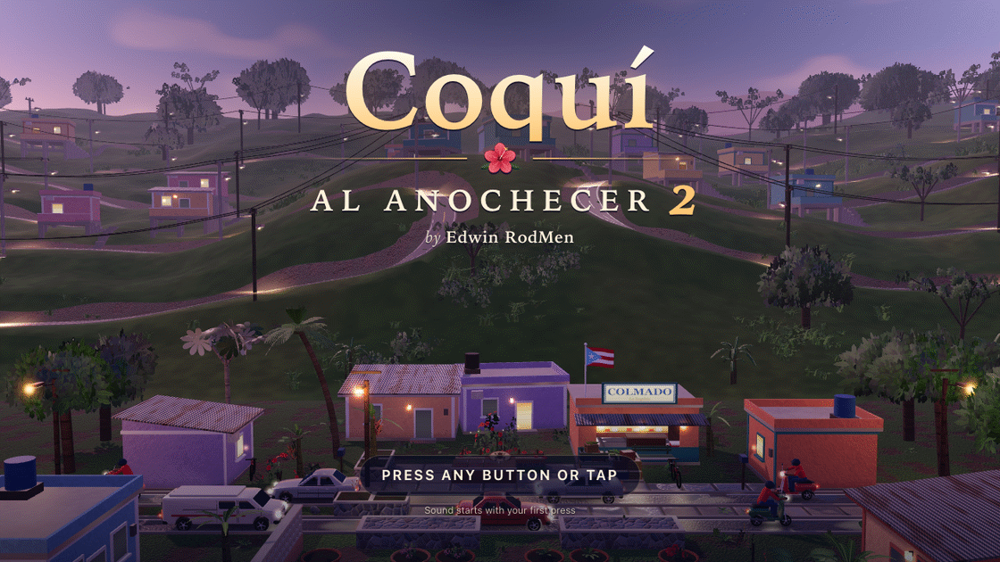

> **Version 0.12.5: an early version.** All seven of the game's regions are
> here: El Barrio, Viejo San Juan, El Yunque, Los Guajonales, Sierra de Cayey,
> Cabo Rojo and the finale, El Gran Coro, with 48 stages between them, all
> fourteen Challenges, the game's hard mode, and **Battle**, for two to four
> friends, on two arenas.

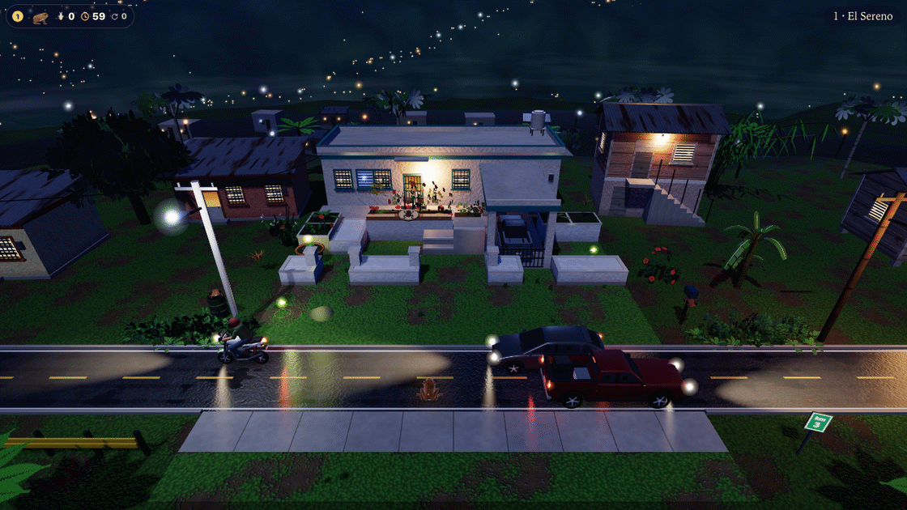

*New in 0.12.5: the journey opens with **El llamado**, a far call over El
Patio at sunset that every frog answers, each region opens with a shot of its
first stage, and an island map shows the way between regions. La Cuchilla,
Battle's second arena, came in 0.11.5; Battle in 0.10.0, on a rock
shelf over a gorge in El Yunque; roomier touch buttons in 0.9.1; all fourteen Challenges, a Hard and an Expert night in every region, in
0.9.0; the first three and the frog view in 0.8.0, and El Gran Coro, the finale,
in 0.7.0.*

## The story so far

This is the sequel to **[Coquí al Anochecer](https://github.com/VibezZzCoder/coqui-snes)**,
the Super NES homebrew game, where a coquí crossed six screens of
one night in a mountain barrio to reach the evening chorus.

The coquí, the little tree frog whose two-note *co-quí* fills every Puerto Rican
night, is out again, and this time the evening goes further. The journey starts
in the barrio of the first game, rebuilt in 3D with heights to climb, and
carries on into the old streets of San Juan, the rainforest of El Yunque, the
granite ravines of Los Guajonales, the mountain roads of the Sierra de Cayey
and the coast of Cabo Rojo.
Each region is one evening, from sunset to full night, and at its end the
chorus answers. Then the coquí goes home for one last night, **El Gran Coro**:
a storm crosses the barrio, breaks and clears, and on the hilltop, in the old
mango tree, the whole island's chorus meets.

|  |  |
|---|---|
| 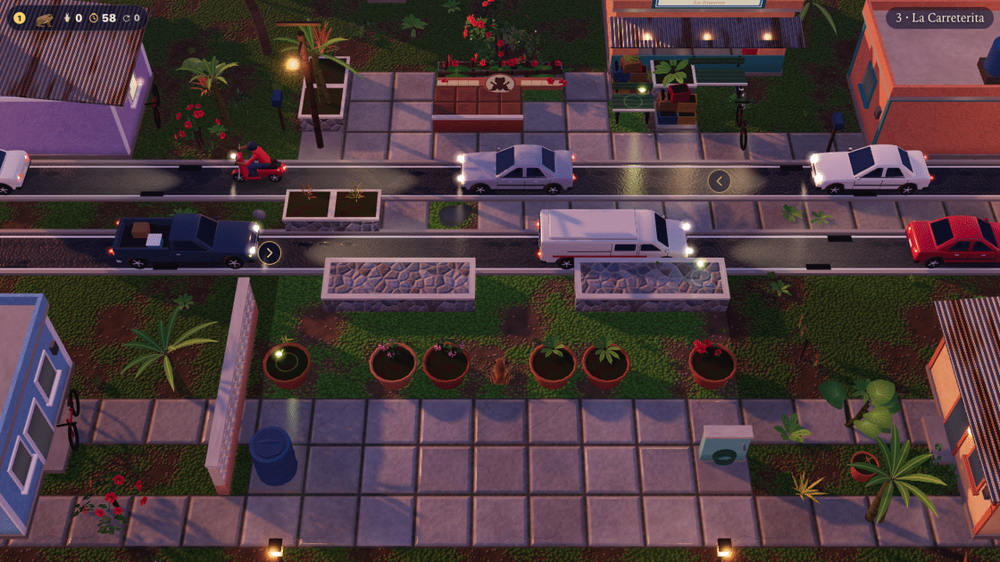 | 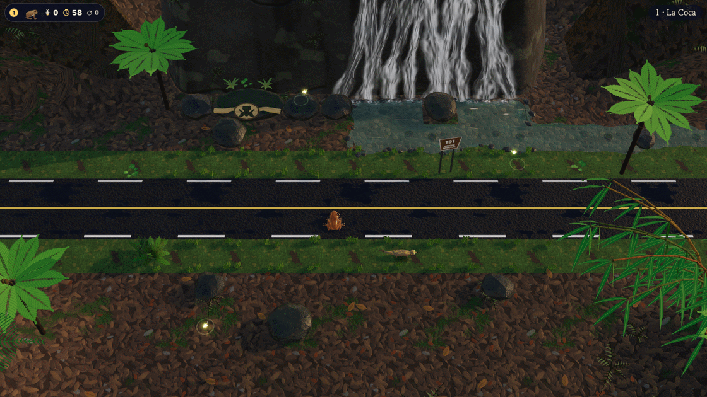 |
| 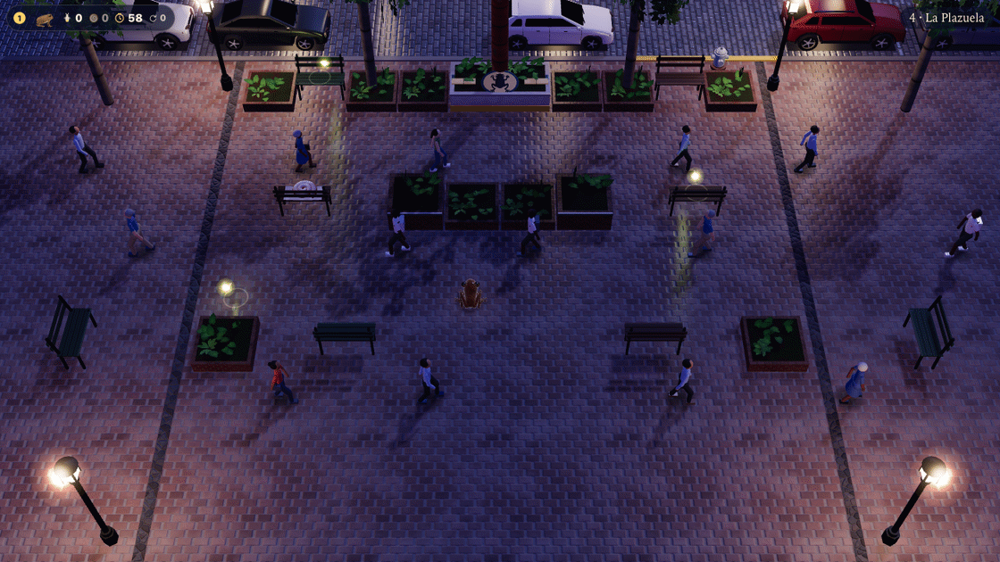 | 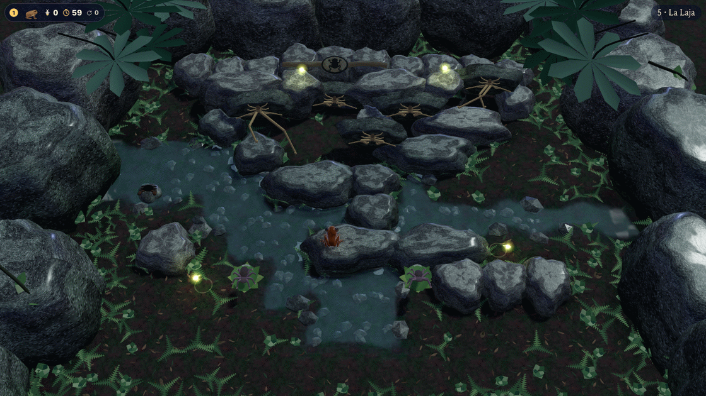 |
| 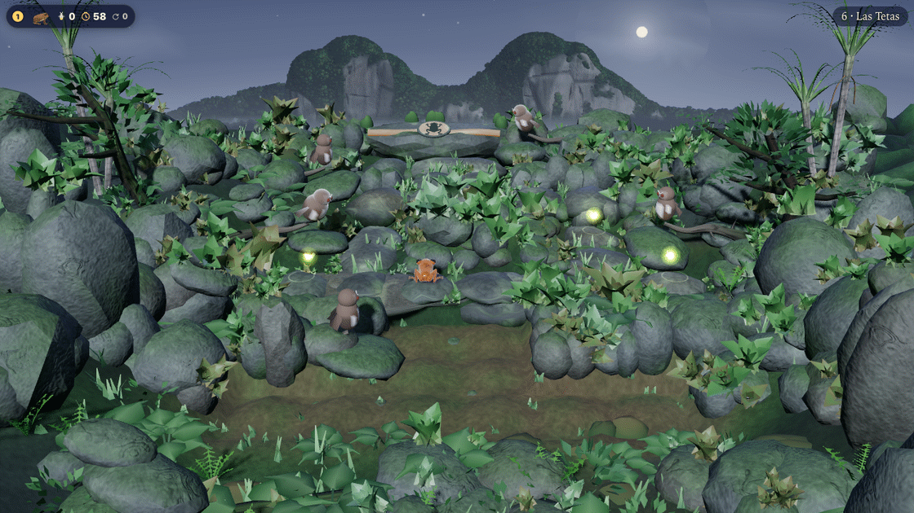 | 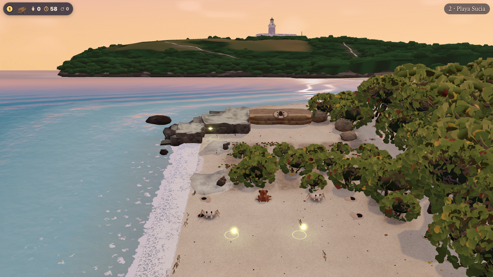 |
| 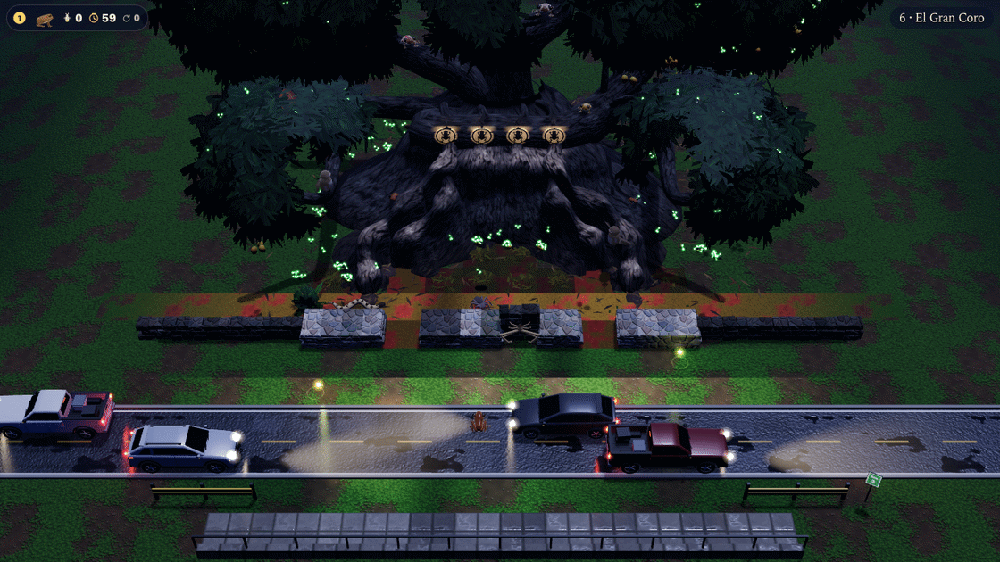 | 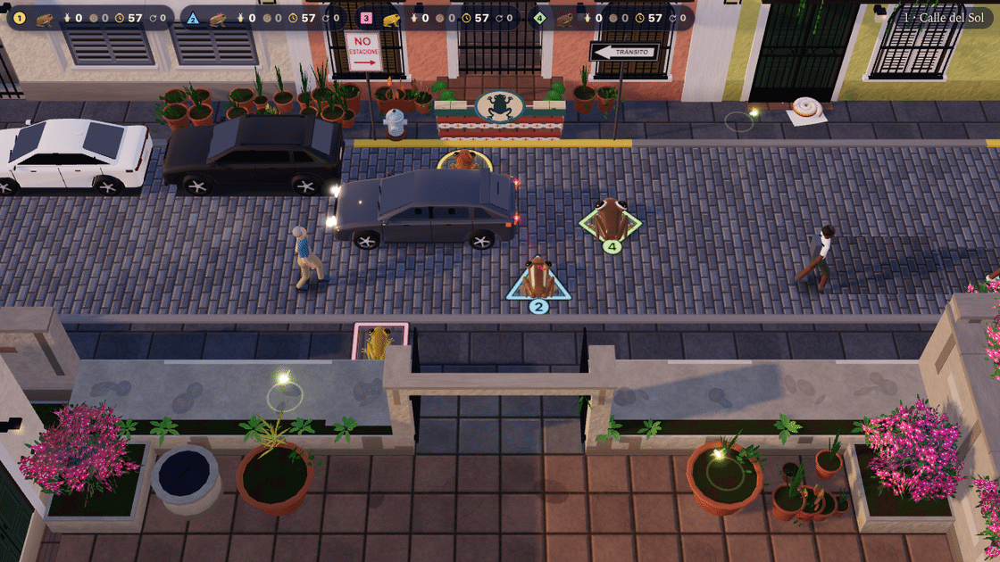 |

*La Carreterita in El Barrio; La Coca in El Yunque; La Plazuela in Viejo San
Juan; La Laja in Los Guajonales; Las Tetas in the Sierra de Cayey; Playa
Sucia, with Los Morrillos lighthouse, in Cabo Rojo; the old mango at the summit
of El Gran Coro; and four friends on Calle del Sol.*

## How to play

**Reach the perch.** Every stage is one screen. Your frog starts at the bottom
and hops, one square at a time, to the perch waiting across the way: a
hibiscus, a planter, a leafy bed, a sheltered granite edge, a mountain
stone seat, a coastal stone bench or, at the very end, the fork of an old
mango tree. With friends, the stage ends when every frog is on the perch.

**One press, one hop.** Each press is one hop in one of four directions, with
no diagonals, and holding a direction does not repeat. A hop is a commitment:
once you jump, you land. A press made during a hop is remembered and taken the
moment you land.

**Climb.** Walls, steps, pots, benches and ledges can be climbed one level at a
time; hop toward one and your frog climbs on. You can drop from any height.
Raised spots let you wait above ground traffic. In El Yunque, also watch
for crab spiders and the múcaro overhead. In Los Guajonales, guabás and
tarántulas can reach raised rock landings too; height alone is no guarantee.
In the Sierra de Cayey, the múcaro swoops onto rocks and ledges as well.

**Call.** Press Call whenever you like and your frog sings its own species'
call. Frogs already on the perch keep singing on their own, so the chorus grows
as friends arrive.

**Insects.** Glowing fireflies hover over squares on every stage.
Hop onto one to catch it for **300** points.

**Hazards.** Cars, motos, pickups and delivery vans on the roads; a hen in the
patio before dusk; a mongoose that rustles in the hedge, then dashes across; the
Puerto Rican boa, long and slow, after dark; and neighbours out walking in the
streets of Viejo San Juan. Headlights and engines tell you a vehicle is on its
way; if you'd like arrows at the edge of the screen too, turn on *Traffic
arrows* in Settings. El Yunque adds slippery mud, rising water, crab spiders
and the múcaro. Los Guajonales adds guabás, tarántulas and shower-fed streams
that rise across the route. The Sierra de Cayey adds mountain roads with a
hairpin bend, steep climbs watched by several múcaros at once, and cloud on
the ridge that dims the distance but never hides a warning. Cabo Rojo brings
shore crabs, surf washing over the beach, salt-pan tide gates, Cuban tree frogs
and yaboas watching the mangroves and harbour. El Gran Coro brings the
mountain's own back for one night: three lanes of traffic on a hairpin, rain
that floods the paths, a stream in flood, fog on a coffee slope, and two
múcaros over the old mango. Watch the scenery and choose your moment to hop.

**Tumbles, not lives.** If something catches you, your frog tumbles and pops
back at its own start square. There are no lives and no game over: try again as
often as you like. Nobody else is sent back.

**The bonus clock.** Each frog has 60 seconds of bonus time that runs while it
is on its way, and keeps running while it picks itself up after a tumble.
Reaching the perch is worth **500**, and every second left is worth **10**.

**Help when you want it.** After six tumbles on a stage, press Call while
standing on your start square to show which hops are safe right now. After
ten, you can skip to the perch instead: a skipped frog scores the clear points
but no bonus, and the records note the skip. Playing alone, you can also turn
the safe-hop highlight on from the first stage, in Settings.

**End of the evening.** After a region's last stage comes *Evening complete*:
your totals, and a title for every frog, from *Not a Scratch* and *Insect
Hunter* to *Bounce-Back Coquí*, *Biggest Prankster* and *Tumble Champion*.
The journey's very last stage ends its own way, with the chorus, a short ending
and the credits.

**Cutscenes.** El Gran Coro tells its night in short scenes. The first time,
each one plays through; after that, a tap or press shows a **Skip** button in
an upper corner.

## Controls

Two players can share one keyboard: one on the left (the WASD half), one on
the right (the arrow half).

| Action | WASD half | Arrow half |
|---|---|---|
| Hop | **W A S D** | **Arrow keys** |
| Call / confirm | **E** or **Space** | **Enter**, **Right Shift**, **Numpad Enter** or **Numpad 0** |
| Back | **Q** | **Backspace** |
| Pause | **Esc** | **P** |
| Frog view (playing alone) | **C** | **/** |

**Keyboard keys can be changed** in Settings → Keyboard: choose an action, then
press its new key. *Reset keys* brings back the defaults.

| Action | Controller |
|---|---|
| Hop | D-pad, or the left stick (one hop per push) |
| Call / confirm | The bottom face button: **A** on Xbox, **✕** on PlayStation, **B** on Nintendo |
| Back | The right face button (**B**, **○**, or **A** on Nintendo), or Back / Select |
| Pause | **Start**, **Options** or **+** |
| Frog view (playing alone) | The top face button: **Y** on Xbox, **△** on PlayStation |

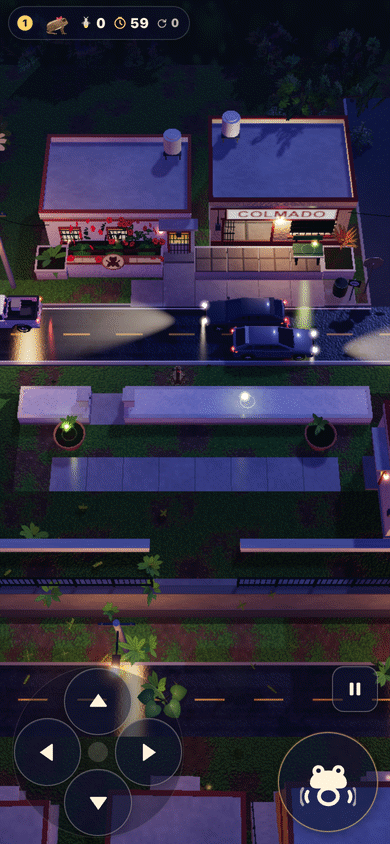

**On a touch screen**, swipe on the stage to hop, or tap the on-screen arrows.
The large **Call** button calls and the small **Pause** button pauses; playing
alone, the small camera button (a frame around a coquí) switches to the frog
view and back. The
buttons appear with your first touch: below the stage when the phone is upright,
at the sides when it is turned. Settings → *Touch button size* makes them
smaller or larger.

**In the menus**, move up and down, change a setting with left and right, and
choose with Call. A mouse or a tap works too.

 

## Playing with friends

Up to **four** frogs on one screen: two on the keyboard, the rest on
controllers, and one player can use the touch screen.

1. On **Choose your frogs**, each new player presses Call on their own device:
   **E** on the WASD half, **Enter** on the arrow half, **A** on a controller,
   or *Tap to join* on the touch screen.
2. Pick a frog with left and right, then press Call to get ready. Each frog can
   only be picked once.
3. When everyone is ready, anyone's Call (or a controller's Start) begins.

Press Back to stop being ready, and Back again to leave.

Nobody wins and nobody loses on the journey (for a contest, try
[Battle](#battle)). Everyone crosses at their own pace, and a tumble only sends
that frog back. Hop into a friend and you bump them one square along
(a *Bump!*, or a *Prank!* if they get caught right after). If a controller
disconnects, the game pauses until it comes back, or until someone presses Call
on a free controller or keyboard half to take over that frog.

## Battle

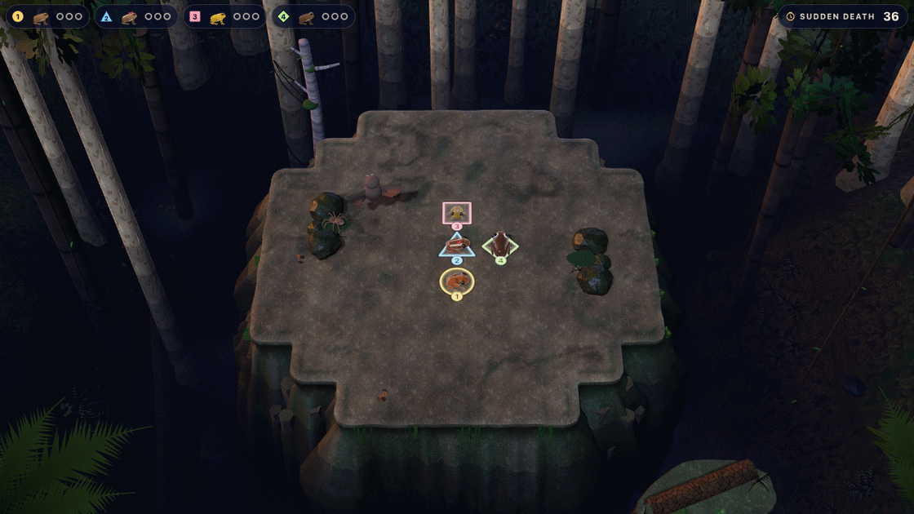

**Last frog standing.** Two to four friends share one screen. Hop into a frog to
shove it one square; shove it over the edge and it is out, and a hop of your own
over the edge puts you out too. The last frog on the rock wins the round, and the
first to win **three** rounds wins the match. If the last frogs go out together,
the round is a draw and nobody scores.

### El Claro

A shelf of volcanic rock over a deep gorge in El Yunque. **The forest joins
in:** the múcaro swoops on the patch it marks with its
shadow, and two giant crab spiders strike from their pockets in the rock; a
frog caught by any of them is out. Then comes **sudden death**: the rock falls
away from the outside in, ring by ring, each ring cracking before it goes, until
one foothold is left.

### La Cuchilla

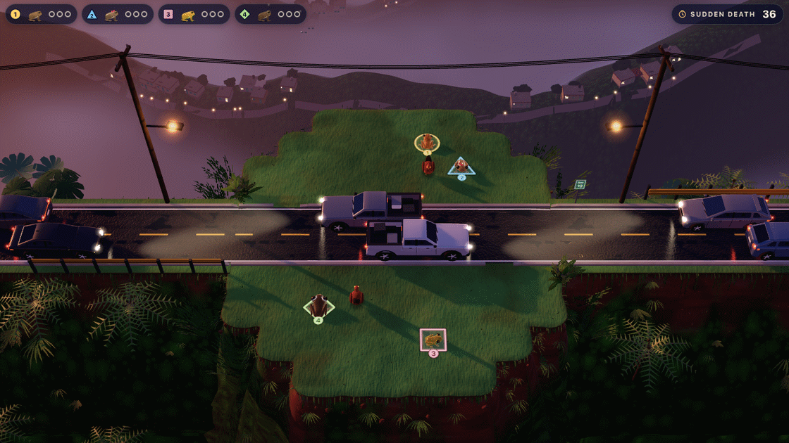

A two-lane road along a ridgetop in El Barrio at dusk, with a drop on both
sides. **Cars** come round the bend, their headlights sweeping ahead of them,
and a frog they hit is out. Then the **hens** come up the banks: a hen shoves a
frog one square but never knocks it out. The traffic picks up, and then comes
**sudden death**, the *derrumbe*: the ridge gives way from the edges in, the
road is closed, and the last cars drive through.

**Choose the arena and the pace** on the same plate (Left/Right, or tap the
arena's name). *Normal* gives room to plan, with sudden death at one minute;
*Fast* is a rush from the start, with sudden death at 45 seconds on El Claro
and 28 on La Cuchilla.

1. Choose **Battle** on the main menu, then the arena and the pace.
2. Each player presses Call on their own controller or keyboard half to join,
   picks a frog (all four are free) and gets ready. Anyone's Call or Start
   begins.
3. Frogs that are out watch from a fallen log and can still call. After the
   match: *Rematch*, *Change players* or *Main menu*.

Battle is made for **controllers**: two players sharing one keyboard can miss
presses made at the same moment. Anyone can pause. Nothing in Battle is saved.

## The frogs

All four hop, climb and call the same way; they differ in look, size and voice.

| Frog | Species | Look | Call |
|---|---|---|---|
| **Coquí** | Common coquí, male (*Eleutherodactylus coqui*) | Brown, like the first game | *co-quí* |
| **Coquí hembra** | Common coquí, female | Larger, striped, with a ribbon | A soft long note, then short notes |
| **Coquí dorado** | Golden coquí (*E. jasperi*) | Uniform gold, smallest, a tribute | *tweet-tweet-tweet* |
| **Guajón** | Rock frog (*E. cooki*) | Plain brown, big white-rimmed eyes | Low, melodious notes |

With friends, all four frogs are free from the start. Playing alone, you start
with the two common coquís. Reach **La Grieta**, the fourth stage of Los
Guajonales, to unlock the guajón for later solo selections, and **Las
Bromelias**, the fourth stage of the Sierra de Cayey, to unlock the golden
coquí.

## What's in version 0.12.5

An early version, with **all 7 regions**, the fourteen
[Challenges](#challenges) and [Battle](#battle) on two arenas:

| El Barrio: 7 stages | Viejo San Juan: 6 stages | El Yunque: 7 stages |
|---|---|---|
| 1. El Patio | 1. Calle del Sol | 1. La Coca |
| 2. La Vereda | 2. La Caleta | 2. El Tabonuco |
| 3. La Carreterita | 3. El Callejón | 3. La Poza |
| 4. La Marquesina | 4. La Plazuela | 4. La Palma de Sierra |
| 5. El Colmado | 5. Calle de la Luna | 5. El Palo Colorado |
| 6. El Cafetal | 6. La Escalinata | 6. El Aguacero |
| 7. El Coro | | 7. El Bosque Enano |

| Los Guajonales: 8 stages | Sierra de Cayey: 6 stages | Cabo Rojo: 8 stages |
|---|---|---|
| 1. El Potrero | 1. La Lechonera | 1. Los Morrillos |
| 2. El Seboruco | 2. La Curva | 2. Playa Sucia |
| 3. Los Peñones | 3. La Finca | 3. Las Salinas |
| 4. La Grieta | 4. Las Bromelias | 4. El Bosque Seco |
| 5. La Laja | 5. La Neblina | 5. El Manglar |
| 6. El Risco | 6. Las Tetas | 6. El Poblado |
| 7. La Cueva | | 7. Puerto Real |
| 8. El Guajonal | | 8. La Plaza |

| El Gran Coro: 6 stages |
|---|
| 1. El Sereno |
| 2. La Cuesta |
| 3. Los Zocos |
| 4. La Quebrada |
| 5. La Jalda |
| 6. El Gran Coro |

### What's new in 0.12.5

- **El llamado:** the journey now opens at sunset in El Patio, where a far
  coquí calls from up the hill and every frog in the party answers before it
  sets off.
- **Region openings:** the first stage of each region opens with a short shot
  of the place, from Calle del Sol's balconies to the lighthouse at Los
  Morrillos, before the camera settles into play. After the first time, you
  can skip it.
- **The island map:** between regions, a night map of Puerto Rico shows the
  trail so far as your frogs hop on to the next region together.
- **Sound:** the summit's road no longer churns under the finale's last scenes,
  and with Frog calls turned down to zero, faraway calls no longer leave a faint
  echo.

### What's new in 0.11.5

- **La Cuchilla:** Battle's second arena, a ridge road in El Barrio at dusk.
  Dodge the cars, mind the hens, and outlast the *derrumbe* as the ridge falls
  away and the road closes, to the barrio's own music. Choose it on the pace
  plate. See [La Cuchilla](#la-cuchilla).
- **Battle on small screens:** knock-out messages wrap instead of running off
  the screen, the countdown keeps clear of the frogs' start marks, and the
  scores fit along the top of the narrowest phones.

### What's new in 0.10.0

- **Battle:** a new mode for two to four friends on one screen: shove each
  other off a rock shelf over a gorge in El Yunque, dodge the múcaro and the
  crab spiders, and hold on through sudden death as the rock falls away. First
  to three round wins takes the match, at a Normal or a Fast pace. See
  [Battle](#battle).

### What's new in 0.9.1

- **Roomier touch buttons:** the four arrows now stand clearly apart, and the
  frog-view button has its own space instead of squeezing between Pause and
  Call: at the top of the button band when the phone is upright, midway between
  Pause and Call when it is turned. Call keeps its full size.
- **A clearer frog-view button:** a camera frame around a coquí's face (or
  around the board, to go back). It now appears with the other buttons as each
  stage begins, instead of a moment later.
- **A quieter ending:** the far generator on the summit runs down as the final
  chorus begins, instead of chugging under the closing scenes.
- **Challenges open for a finished journey:** a save that has completed
  El Gran Coro always opens the Challenges.
- **Credits:** the version line no longer says Challenges are still to come.

### What's new in 0.9.0

- **All fourteen Challenges:** eleven new ones join the first three, so every
  region now has a Hard and an Expert night: El Coro, La Plazuela, Calle de la
  Luna, La Poza, La Palma de Sierra, Los Peñones, El Risco, La Curva, Puerto
  Real, Los Zocos and La Jalda.
- **Help stays off the road:** help and skip offers now show in one line,
  below the stage where there is room or else under the scores, never over the
  crossing in front of you, with each player's own Call key. In a Challenge each offer shows once per
  attempt.
- **The Challenge list says when there is more below**, and scrolls there on a
  click.
- **Puerto Real:** the houses on the far hillside now catch the moonlight
  instead of standing out as black blocks.

### What's new in 0.8.0

- **The first three Challenges:** once the journey is complete, the menu's
  Challenges open with harder remixes of La Carreterita, Las Bromelias and
  Playa Sucia, each with its own records and badges. (The other eleven
  followed in 0.9.0.)
- **Frog view:** playing alone, press **C** (or **/**, the controller's top face
  button, or the small button above Call) to put the camera right behind your
  coquí for a close look; press again to return to the whole stage. Settings →
  Play remembers it.
- **Help waits longer:** help is offered after six tumbles on a stage and the
  skip after ten, instead of three and five.
- **The title hillside:** open pasture, grass and wooded ridges instead of
  rows of round bushes, with power lines on proper roadside poles and street
  lamps that light the road.
- **Fixes:** Playa Sucia's headland and lighthouse, the distant plaza in La
  Plaza and the peaks of Las Tetas no longer change shape while the camera
  moves.

### What's new in 0.7.1

- **Stage openings:** the camera swoops down into place as each stage begins,
  and the stage's name and line stay on screen long enough to read. With
  *Reduce motion* on, the camera stays still.
- **A new coquí on every finish:** the medallion on each stage's finish line
  has a newly drawn coquí, toe pads and all.
- **The flag stays:** once you've finished the journey, the flag of Puerto Rico
  flies over the colmado behind the title and menus.
- **Fixes:** the potted plants in El Patio grow from the middle of their pots,
  and Cabo Rojo's parked cars no longer show dark squares in their windows on
  High graphics.

### What's new in 0.7.0

- **El Gran Coro, the finale:** one night back in the barrio where the journey
  began. A storm builds over La Cuesta and breaks over Los Zocos, the ravine of
  La Quebrada runs in flood, fog fills the coffee rows of La Jalda, and on the
  hilltop, under the Milky Way, the friends of the whole journey wait in the old
  mango tree.
- **A chorus that grows:** each stage adds the next region's instrument to the
  barrio's tune, until the summit gathers them all.
- **An ending:** a wordless closing scene, the golden coquí, and credits that
  look back over every region.
- **Throats, not bubbles:** in every region, a calling frog's throat now swells
  from the jaw instead of a round sac.
- **Traffic you don't see coming:** the arrows at the edge of the screen are
  now a setting, *Traffic arrows*, off unless you turn it on. Headlights and
  engines still warn you.
- **Settings say what they change:** the comfort options note how they alter
  the game, so you can choose knowingly.

### What's new in 0.6.1

- **Calmer backgrounds:** quieter ambience, longer insect lulls and more space
  between animal calls across all six regions.
- **Less repetitive effects:** shorter mongoose footstep bursts and softer
  distant traffic and environmental sounds, while keeping nearby hazard warnings.
- **A natural return:** after attacking in El Bosque Seco, the Cuban treefrog
  turns toward its tree and jumps back head-first before settling on the bark.

### What's new in 0.6.0

- **Cabo Rojo:** eight stages from Los Morrillos lighthouse at sunset to the
  church and plaza at full night, with Playa Sucia's bay, pink salt pans, dry
  forest, mangroves and fishing boats along the way.
- **Coastal encounters and music:** timed surf and tide gates, shore crabs,
  Cuban tree frogs and yaboas, accompanied by Cabo Rojo's own *Retreta*.
- **Water and sound polish:** calmer reflections, softer ripples, finer coastal
  foam and clearer shallow streams; the animals at Los Morrillos leave quiet
  gaps between their footsteps.
- **More room for friends:** broader entrances at El Manglar and La Plaza let
  outer frogs leave while their friends wait.

### What's new in 0.5.1

- **Smoother co-op moments:** when the múcaro catches several frogs at once,
  its swoop now visibly reaches each of them and no longer brushes through the
  farm gate at La Finca; and frogs crowding onto a perch together, even with a
  skip, no longer overlap or swap places as they settle.

### What's new in 0.5

- **Sierra de Cayey:** six stages on the mountain roads and ridges, from a
  roadside lechonera at sunset to the saddle of Las Tetas at full night.
- **New encounters and sound:** a hairpin bend where the traffic follows the
  curve, cloud on the ridge road, bromeliad climbs under several múcaros at
  once, and a slow new score for cuatros and guitar.
- **The golden coquí joins solo play:** reach Las Bromelias to unlock it.
- **Smaller changes everywhere:** the help and skip prompt fades after a few
  seconds and comes back when you return to your start square; frogs arriving
  together make room for each other on the perch; and wherever the múcaro
  hunts, its warning is a short call and its swoop reaches every frog it
  catches.

Each region's stages run from sunset to full night. Finishing El Barrio carries
you into Viejo San Juan, then El Yunque, Los Guajonales, the Sierra de Cayey,
Cabo Rojo and, last, El Gran Coro. **Continue journey** picks up at the stage
you were on, and **Choose region** replays any region you have reached. Once
the journey is complete, the menu offers to replay the finale.

### Challenges

The **Challenges** on the menu open after the whole journey. They are the hard
mode: remixes of journey stages with faster traffic, more hazards and tighter
gaps. Each region has a Hard night and an Expert one; try Hard first, though
Expert is open too.

| Region | Hard | Expert |
|---|---|---|
| El Barrio | **La Carreterita** | **El Coro** |
| Viejo San Juan | **La Plazuela** | **Calle de la Luna** |
| El Yunque | **La Poza** | **La Palma de Sierra** |
| Los Guajonales | **Los Peñones** | **El Risco** |
| Sierra de Cayey | **La Curva** | **Las Bromelias** |
| Cabo Rojo | **Playa Sucia** | **Puerto Real** |
| El Gran Coro | **Los Zocos** | **La Jalda** |

Each Challenge keeps its own records, alone and in a group: the clear, the
fastest time and the best score, and two badges, *No tumbles* and *All
insects*. Help is still there if you need it, but an attempt that uses it (or
the safe-hop highlight) counts as *assisted* and earns no badges. Skipping to
the perch ends the attempt with no credit, so the game asks for Call twice.
The frog view is only a viewpoint, and never counts as help.

### Mallorcas

Viejo San Juan hides one *mallorca* on each of its stages, on a doorstep or a
bench: Puerto Rico's sugar-dusted spiral sweet bread, fresh from the panadería.
Hop onto it for **500** points. The first frog to land takes it, the results
count how many of the six you found, and the game remembers every one. They are
here because a player of the first game asked for them.

## Settings

| Group | What you can change |
|---|---|
| **Sound** | Master, Music, Night ambience, Frog calls and Effects volumes |
| **Display** | Quality (*Auto* adapts to your device; or High, Medium, Low), Reduce motion, Text size, High-contrast HUD, and a frame-rate readout |
| **Play** | Safe-moment highlight when playing alone, Frog view (playing alone), Traffic arrows, and touch button size |
| **Keyboard** | New keys for both halves of the keyboard, or *Reset keys* |
| **Save data** | *Erase save data*, from the main menu's Settings only, asked twice |

## Saving

The game saves by itself: how far your journey has gone, your best scores and
times, your Challenge records and badges, the insects and mallorcas you have
found, the cutscenes you have watched, and your settings. There is no account.

Everything is kept **in this browser, on this device**. Another browser, another
device or a private window starts fresh, and clearing this site's data in your
browser erases the save. On iPhone and iPad, the Home Screen copy of the game
keeps a save of its own, separate from Safari's. Safari also clears a site's
data after seven days of using Safari without visiting it, and playing from the
Home Screen avoids that.

## Put it on your home screen

Added to your home screen, the game opens like an app, without the browser's
address bar and tabs, and the stage gets the whole screen.

**iPhone and iPad (Safari)**

1. Open [the game](https://vibezzzcoder.github.io/coqui-3d/) in Safari.
2. Tap **Share**. On iPhone, Share sits in the menu beside the address bar;
   you can also press and hold the address bar.
3. Tap **Add to Home Screen**. If you don't see it, tap **View More** first.
4. Leave **Open as Web App** on, and tap **Add**.

The game's title screen reminds iPhone players: *Share → Add to Home Screen*.
Chrome on iPhone and iPad can do the same from its Share button.

**Android (Chrome)**

1. Open [the game](https://vibezzzcoder.github.io/coqui-3d/) in Chrome.
2. Tap the **⋮** menu.
3. Tap **Add to Home screen**, **Install app** or **Install and create
   shortcut** (the wording depends on your version of Chrome).
4. Tap **Install**. On Android it opens truly full screen.

**Computer**

| Browser | How |
|---|---|
| Chrome | **⋮** → **Cast, save, and share** → **Install page as app…** |
| Edge | **…** → **Apps** → **Install this site as an app** (in some versions under **More tools**) |
| Safari on a Mac | **File** → **Add to Dock** (macOS Sonoma or later) |

You still need an internet connection to start the game. Once it is open,
nothing more is downloaded.

## Everything is generated in code

There are no image, sound, music or font files in this game. The 3D world, the
frogs, their textures and the evening sky are built by the game's own code as
it runs; every call, every sound and all of the music is synthesized by that
code while you play; and the text uses your device's own fonts. The only
pictures here are the icons, drawn from the game's own frog art, and the
screenshots in `media/`, captured from this very build.

## Troubleshooting

- **No sound?** Browsers keep sound off until your first key press, click or
  tap. A controller button alone can't start it, so press a key or tap the
  screen once. Then check the volumes in Settings.
- **iPhone in Silent mode?** The game asks iPhone and iPad to treat its sound
  like music playback, so on iOS 17 or later it should play even in Silent
  mode, and it may pause music playing in another app. If you hear nothing,
  turn up the volume with the side buttons.
- **Controller not recognised?** Browsers only reveal a controller after one of
  its buttons is pressed while the game is open. Connect it, then press a
  button; on *Choose your frogs*, press **A** (**✕**, or **B** on Nintendo) to
  join.
- **Upright or sideways?** Both work, on phones and tablets alike. Some stages
  are tall and some are wide, so turning the device can give a stage more room.
- **Choppy?** Try Settings → Quality → Medium or Low, and close other tabs.
- **Stuck on the game's name on a dark screen?** The game needs a current
  browser with JavaScript and WebGL turned on. Try an up-to-date Chrome, Edge
  or Safari.

## Credits

**Coquí al Anochecer 2** is a game by **Edwin RodMen**.

- This game: <https://github.com/VibezZzCoder/coqui-3d>
- Instagram: [@edwin_rodmen](https://www.instagram.com/edwin_rodmen/)
- YouTube: [@EdwinRodMen](https://www.youtube.com/@EdwinRodMen)
- The first game, *Coquí al Anochecer* for the Super NES: <https://github.com/VibezZzCoder/coqui-snes>

Built with [three.js](https://threejs.org/) (MIT License).

## License

**Free to play, free to share.** Play it as much as you like, and share the
official game, complete and unchanged, with its credits, `LICENSE` and
`NOTICE.md`, always free of charge.

**Videos are welcome.** Stream it, record it, review it and post screenshots,
monetized or not, without asking first.

**Fan art is welcome too.** Draw it, cosplay it, write about it or play its
music your own way, and share it free of charge. Just make it yourself rather
than copying the game's files, and don't present it as official.

**Please don't** sell it or charge for access to it; change it, rename it or
rebrand it; pass it off as someone else's; or copy its code, art, music,
sounds or stages into other work.

The full terms are in [`LICENSE`](LICENSE). [`NOTICE.md`](NOTICE.md) covers
authorship, the places the game depicts, and the three.js license. For anything
else, ask in the [repository](https://github.com/VibezZzCoder/coqui-3d).

## What's in this repository

| File | |
|---|---|
| `index.html` | The whole game, in one file |
| `manifest.webmanifest`, `icons/` | The name and icons for your home screen |
| `media/` | The screenshots above |
| `LICENSE`, `NOTICE.md` | The terms, authorship and notices |
| `SHA256SUMS.txt` | Checksums: `shasum -a 256 -c SHA256SUMS.txt` should report `OK` for every file |

---

© 2026 Edwin RodMen. All rights reserved. · [@edwin_rodmen](https://www.instagram.com/edwin_rodmen/) · [YouTube](https://www.youtube.com/@EdwinRodMen)
